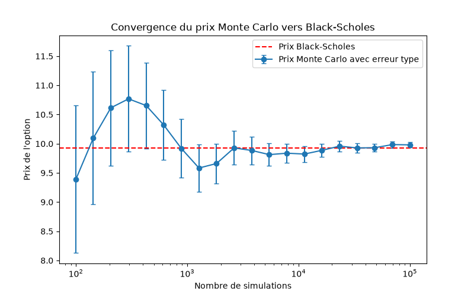

# Monte Carlo option pricer

We compute the price of a European call with two methods: one with a Monte Carlo simulation and one with the Black-Scholes formula. Then we compare them to see if the Monte Carlo price converges to the Black-Scholes price.

## How to run

```bash
python -m venv venv
venv\Scripts\activate
pip install -r requirements.txt
python convergence.py
```

Each file can also be run on its own to check that it works, for example `python black_scholes.py`.

## Result



We can clearly see that the Monte Carlo price converges to the Black-Scholes price, and that the uncertainty goes down when we use more simulations.
